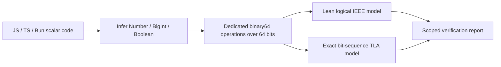

# JavaScript Number verification

JS, TypeScript and Bun scalar-v2 profiles support IEEE 754 binary64 `number`.
They preserve rounding, subnormals, infinities, NaN and both zero signs. Number
operations are distinct from mathematical integers and fixed-width integer
arithmetic. No real-number approximation is used.



## Source syntax and input types

```typescript
function calculate(a: number, b: number) {
    const total = a + b;
    return total;
}
```

Unannotated JS/TS/Bun functions are also accepted within the same scalar domain. Parameter and return types are
inferred monomorphically from annotations, literals, operators and direct calls.
Unconstrained types default to Number. BigInt literals such as `1n` constrain
their arithmetic and connected call signatures to BigInt. `number`/`bigint`
mixing and implicit coercion are rejected.

For a function with no type-determining use, such as `function copy(a) { return a; }`,
select BigInt explicitly when needed:

```sh
formal translate --language javascript --source input.js --default-numeric bigint --output Draft --draft-unvalidated
```

`--default-numeric number|bigint` applies only during JS-family generation. It
selects unresolved types and does not override annotations or constraints.
Generation reports record the selection. Artifact rechecking uses the types and
operations already in the artifact and rejects that option.

Supported numeric expressions include decimal and exponent literals, `NaN`,
`Infinity`, unary `+`, `-`, `!`, arithmetic `+ - * / %`, numeric comparisons,
`===`/`!==`, and matching-domain `==`/`!=`. Number equality follows IEEE rules;
`NaN === NaN` is false, and `-0 === 0` is true. `Object.is` distinguishes zero
signs and equates NaNs. `Number.isNaN`, `Number.isFinite`, `Number.isInteger`,
`Number.isSafeInteger`, and `Math.abs` are supported pure numeric builtins.

Number/BigInt/Boolean truthiness works in conditionals. `&&` and `||` short-circuit
and preserve the selected operand, with matching scalar operand types.
Expressions producing a union of different scalar types are rejected. Immutable
`let`/`const` bindings, calls and conditional returns use the existing scalar
profile. Semicolons may be omitted at supported newline/closing-brace boundaries;
expressions remain single-line. Assignment, arrays, strings, objects, arbitrary
member access, imports, loops and async remain outside this source profile.

JS/TS/Bun files accept LF and CRLF line endings. Isolated CR bytes, including
inside comments, are rejected before artifact generation. A newline immediately
after `return` can produce `undefined` in JavaScript; that result is outside this
scalar profile and is rejected. Regenerate older JS/TS artifacts whose source
contains isolated CR; artifact rechecking audits the existing model and does not
rerun the source frontend.

## All-input properties

`properties.json`:

```json
{
  "schemaVersion": 1,
  "properties": [{
    "name": "ieee_sum",
    "entry": "calculate",
    "inputViews": ["number", "number"],
    "resultView": "number",
    "requires": "true",
    "ensures": "sameValue(result, arg0 + arg1)"
  }]
}
```

```sh
formal check --language bun --source input.ts --properties properties.json --output Checked
```

A `number` view interprets width-64 input patterns as binary64. All patterns are
quantified, including exceptional values and signed zero. Decimal property
literals and every Number arithmetic operation round to binary64. `sameValue`
uses the same semantics as `Object.is`; ordinary `==` remains numeric equality.
Predicates include `isNaN`, `isFinite`, `isInteger`, `isSafeInteger`, and
`isNegativeZero`. Mixing integer-view and Number operands is rejected. With a Number view present,
numeric literals are Number literals; integer-only literal conditions belong in
a separate integer-view property.

A property such as `result == arg0 + arg1` can fail on NaN, even when the source
returns exactly that sum. Properties are not rewritten using real arithmetic.
Automatic proof search is incomplete and remains bounded. An unresolved theorem
reports `UNPROVED` or `UNKNOWN`, never success based on sampled inputs.

## Finite scenarios and exact observations

Number scenarios specify views explicitly; omitting views retains legacy
integer/bit-value parsing.

```json
{
  "schemaVersion": 1,
  "fuel": 32,
  "cases": [{
    "name": "rounding",
    "entry": "calculate",
    "arguments": ["0.1", "0.2"],
    "inputViews": ["number", "number"],
    "resultView": "number",
    "expected": {"status": "returned", "value": "bits:3fd3333333333334"}
  }]
}
```

Values accept decimal notation, `NaN`, `Infinity`, `-Infinity`, or `bits:` followed
by 16 hexadecimal digits. Raw bits preserve zero signs and avoid JSON numeric
rounding. For example, negative zero is `bits:8000000000000000`. NaN payloads are
canonicalized because payload-observing memory APIs are outside the profile.
Expected Number results compare canonical bits rather than numeric equality.

## Verification and compatibility

Native Node/Bun observations are compared against Swift IR, actual Lean kernel
reductions and actual TLC execution. Lean uses the pinned standard logical
Float model, not native proof reduction. The standard three-axiom allowlist is
unchanged. TLA arithmetic operates on exact bit sequences; its Number results
are not computed using TLC machine-integer significands.

Version 0.4.0 updates runtime identity and JS-family profiles. Regenerate older
artifacts before rechecking them with this version; a runtime hash mismatch is
an integrity error. BigInt users of unconstrained JS functions should select
`--default-numeric bigint`. Other source profiles retain their integer meanings.
General source-to-model semantic preservation remains `UNVALIDATED`.

The [IR execution contract](../Sources/FormalIR/Execution/DESIGN.md#binary64-number-contract)
owns Number semantics. Developer reproduction:

```sh
python3 Tools/run-with-timeout.py --seconds 1200 python3 Tools/verify-numbers.py --formal /absolute/path/to/formal
```

Native Node and Bun are required by that differential test, and are not required
for end-user generation or checking. Installed verification uses bundled Java,
TLC and Lean. No additional runtime installation or dependency is introduced.
