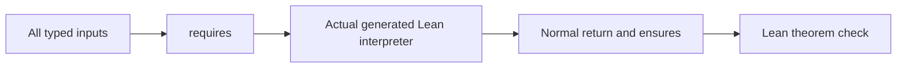

# Universal properties

`formal check --properties properties.json` checks a theorem over **every typed
input satisfying a precondition**. This is separate from `--scenario`, which
checks explicit finite inputs.



## Property specification

```json
{
  "schemaVersion": 1,
  "properties": [
    {
      "name": "addition_is_monotone",
      "entry": "calculate",
      "inputViews": ["integer", "integer"],
      "resultView": "integer",
      "requires": "arg1 >= 0",
      "ensures": "result >= arg0"
    }
  ]
}
```

For an integer addition function, this requests a theorem for all `arg0` and
`arg1` in Lean's `Int`: whenever `arg1 >= 0`, the actual generated interpreter
returns normally and its result is at least `arg0`. It does not enumerate a
range or infer a universal result from samples.

```sh
formal check --language python --source input.py --properties properties.json --output Checked
formal check --artifact Checked --properties properties.json --timeout 120
```

Exactly one of `--properties` and `--scenario` is required. Specifications are
parsed before source generation. Each verification run preserves the exact
property bytes, artifact hashes, proof source and logs in a unique
`verification/<run-id>/` directory.

| Field | Meaning |
|---|---|
| `name` | Unique ASCII alphanumeric/underscore property name |
| `entry` | Existing function symbol |
| `inputViews` | Interpretation of each entry argument, in signature order |
| `resultView` | Interpretation of the returned scalar value |
| `requires` | Boolean precondition over arguments; cannot reference `result` |
| `ensures` | Boolean postcondition over arguments and the returned result |

Unknown fields and ill-typed expressions are rejected.

## Input domains and views

| View | Required IR type | Quantified Lean input | Expression meaning |
|---|---|---|---|
| `integer` | Mathematical integer | `Int` | Unbounded mathematical integer |
| `signed` | Bits of width 1...64 | `Nat`, constrained below `2^width` | Signed two's-complement interpretation |
| `unsigned` | Bits of width 1...64 | `Nat`, constrained below `2^width` | Unsigned integer interpretation |
| `boolean` | One bit | `Bool` | Boolean proposition |

Signed and unsigned views both cover every bit pattern. A view specifies how the
property interprets those patterns; the operations inside the program continue
to follow their IR semantics. Views are explicit because the IR bit type does
not retain the source-language signed/unsigned name. Mathematical integer
quantification has no finite input bound. Parser and arithmetic budgets for
specifications and candidate witnesses do not restrict that domain.

## Expression language

Expressions accept `arg0`, `arg1`, and subsequent argument indices, `result`,
canonical decimal integer literals, `true`, `false`, and parentheses.

| Operators | Operand types | Result |
|---|---|---|
| Unary `-`, binary `+`, `-`, `*` | Integer | Integer |
| `<`, `<=`, `>`, `>=` | Integer | Boolean |
| `==`, `!=` | Matching integer or Boolean types | Boolean |
| `!`, `&&`, `||` | Boolean | Boolean |

Precedence, from strongest to weakest: unary operators, multiplication,
addition/subtraction, ordering, equality, conjunction, disjunction. There is no
implicit Boolean/integer conversion. Raw Lean/TLA code, arbitrary identifiers,
imports, calls, division and quantifiers inside the expression are rejected.
The surrounding property supplies universal quantification automatically.

## Proof contract

For every typed entry input, the checked theorem states:

```text
requires(arguments)
    implies
normal return within the derived bound, with ensures(arguments, result)
```

The proof uses `Generated.program`, `SwiftFormal.initial` and
`SwiftFormal.evaluate` from the actual audited output. Program data is decoded
independently from both emitted languages and compared with `program.json`;
runtime source hashes must match the shipped policy. The source-to-model
translation remains `UNVALIDATED`: a model theorem alone does not certify that
every source-language behavior was translated correctly.

The execution bound is derived from reachable acyclic control flow and direct
calls. It is not an input sample count. The theorem itself checks that every
input satisfying `requires` reaches a valid returned scalar within that bound.
A wrong or insufficient bound cannot produce `PROVED`.

Proof-search hints reconstruct expressions only to choose logical case splits.
They are not an alternative semantics or certificate. Kernel checking of the
actual interpreter obligation is always required. Automation uses controlled
simplification and arithmetic tactics. It is incomplete: a true property may
remain `UNPROVED` or `UNKNOWN`.

Only `propext`, `Classical.choice` and `Quot.sound` are permitted axiom
dependencies. Admissions, custom axioms, `Lean.trustCompiler` and native
reduction axioms are rejected. No user-supplied Lean file or Lake configuration
is executed.

Precondition satisfiability is reported as `NOT_PROVED`. The theorem is an
implication; if its precondition is contradictory, it may be vacuously true.

## Counterexamples

The verifier may search up to 64 deterministic typed candidates, including
integer-width boundaries and constants from the property. This search can find
a counterexample but can never prove a universal claim.

`COUNTEREXAMPLE` requires all of the following:

1. The bounded IR interpreter finds a typed input satisfying `requires` that
   fails to return normally or violates `ensures`.
2. Lean kernel-checks the negation of the same interpreter obligation for that
   input, together with its input-domain bounds.
3. TLC reaches the reported bad outcome for the same input in the actual TLA+
   model and violates an invariant excluding that outcome.

Lean establishes the property violation. TLC confirms the concrete outcome using
bit-sequence values, avoiding TLC's bounded machine-integer arithmetic when
handling 64-bit or large integer witnesses. Failure to find a witness does not
establish validity.

## TLA+ output

Each property emits a universal TLA+ specification whose initial states range
over all typed inputs satisfying `requires`. Its temporal property requires the
postcondition at terminal states. SANY checks syntax and module semantics.

Reports record `tla: SPECIFICATION_GENERATED`, not an exhaustive TLC result.
TLC cannot enumerate an infinite integer domain or practically explore every
64-bit input. Lean owns the all-input proof and bounded normal termination;
general semantic equivalence of the TLA+ and Lean runtimes is not certified.

## Results and limits

| Status | Meaning | Exit |
|---|---|---|
| `PROVED` | All-input interpreter theorem checked; TLA+ specification parsed | 0 |
| `COUNTEREXAMPLE` | Typed violating witness checked by IR, Lean and TLC | 5 |
| `UNPROVED` | Automatic theorem proof did not succeed; falsehood not established | 6 |
| `UNKNOWN` | Unsupported automatic proof shape, bound or timeout | 6 |

Integrity failures use exit 4; invalid specifications use exit 2; tool failures
use exit 7. Aggregate and function values are outside the scalar property
profile. Reachable recursion or CFG cycles require a future inductive proof
profile and return `UNKNOWN`.

The automatic profile accepts 1...16 properties per file, up to 128 arguments,
4096 bytes and 1024 tokens per expression, depth 64, and 256-digit decimal
constants. The derived evaluation bound is at most 4096; at most eight logical
proof cuts are generated. Hint expressions are capped at 32 KiB and proof source
at 1 MiB. Lean has a 1024 MiB memory limit and 1,000,000 heartbeats; per-process
wall-clock timeout defaults to 120 seconds and accepts 1...3600. Tool output and
workspace limits follow the [verification execution contract](../Sources/FormalValidation/Verification/DESIGN.md).
