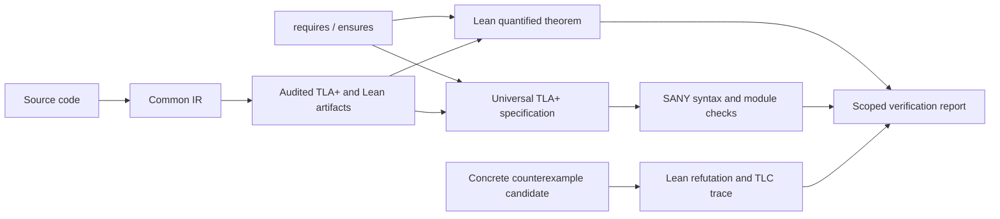
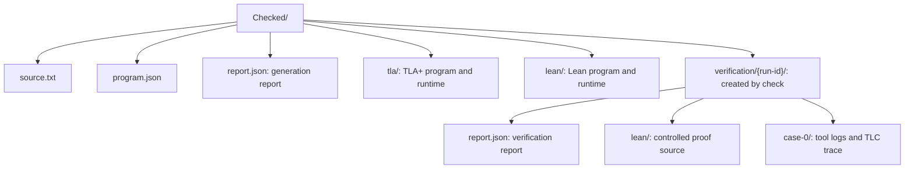
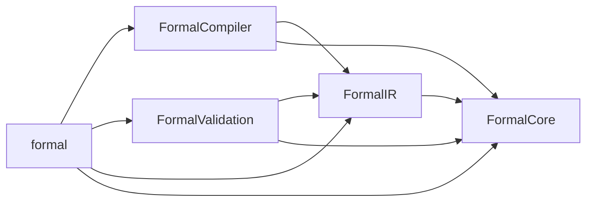

# swift-formal

**Formal models and verification evidence from source code.**

swift-formal is an experimental formal-verification toolchain for checking program logic with TLA+ model checking and Lean proofs. It translates supported source code into mathematical models, proves preconditions and postconditions over all typed inputs, and preserves the models and verification evidence for inspection. Concrete regression cases can also be checked. The CLI is **`formal`**.

It supports scalar functions written in Swift, Rust, C, C++, Go, TypeScript, JavaScript, Python, Java, and Bun through a shared intermediate representation.

## Why use formal

Use swift-formal to check whether supported program logic behaves as intended, investigate unexpected outcomes, and retain verification evidence you can inspect during a review and rerun after a code change.

- **State properties over input domains.** Write `requires` and `ensures` conditions and ask Lean to prove that every typed input satisfying the precondition terminates normally and meets the postcondition.
- **Investigate failures.** Inspect a kernel-checked counterexample and its TLC trace, or an explicit `UNPROVED`/`UNKNOWN` result when automatic proof search cannot finish.
- **Repeat proofs after changes.** Reuse property specifications with pinned verification tools and reports that record source hashes, theorem source, and tool versions.
- **Use one workflow across languages.** Generate and check supported functions with the same CLI while retaining each language profile's integer and overflow semantics.

This is useful for arithmetic and branching logic where boundary conditions and failure behavior matter. Installation manages Java, TLC, and Lean for you, and subsequent checks run offline.

The current implementation proves properties of **audited generated models**. Integer inputs quantify over all mathematical integers; fixed-width inputs quantify over every bit pattern. General source-to-model semantic preservation remains uncertified. Automatic proofs currently cover acyclic scalar control flow and direct calls; recursion, loop invariants, Actor/async, and general application projects require additional proof support. See [implementation progress](PROGRESS.md).

## How it works

`formal check --properties` generates and audits both backends, emits an all-input theorem about the actual Lean interpreter, and checks the theorem with Lean. It also generates a universal TLA+ specification and checks its syntax and module semantics with SANY. TLC confirms concrete counterexamples and remains available for finite regression cases; it is not presented as an exhaustive checker for infinite integer domains.



## Installation

The current distribution target is **macOS on Apple Silicon (arm64)**. The package declares macOS 13 and Swift tools 6.2 as its minimum versions. The tested Swift toolchain is 6.4.1.

### Install from source

Run from the package root. Building the package requires a Swift toolchain.

```sh
git clone https://github.com/1amageek/swift-formal.git
cd swift-formal
swift run -c release formal install --prefix "$PWD/InstalledFormal"
./InstalledFormal/bin/formal toolchain
```

`install` downloads pinned tools and places them inside the chosen prefix.

| Bundled tool | Version | Purpose |
|---|---|---|
| Eclipse Temurin JRE | 21.0.13+9 | Run TLC |
| TLA+ tools | 1.7.4 | Parse and analyze models with SANY; explore states with TLC |
| Lean | 4.35.0 | Check theorems about expected generated-model outcomes |

Archives are checked against pinned SHA-256 digests, and the extracted files are checked against a pinned inventory. Downloads are cached at `~/Library/Caches/formal/downloads`; use `--cache <directory>` to override this location. The extracted tools occupy about 3 GB, with about 1 GB of downloaded archives. The destination version and `bin/formal` must not already exist.

### Install from a binary distribution

If you have a portable distribution folder, install it with:

```sh
./Formal-macos-arm64/formal install --prefix "$PWD/InstalledFormal"
./InstalledFormal/bin/formal toolchain
```

The folder already contains its verification tools. This installation works offline and requires no Swift toolchain. You can also run `formal` directly from the distribution folder. Keep the executable, resource bundles, and `toolchain` directory together. See [distribution and installation](Documentation/DISTRIBUTION.md) for details.

## Quick start

Create the following two files in the working directory containing `InstalledFormal`.

`input.py`:

```python
def calculate(a: int, b: int) -> int:
    return a + b
```

`properties.json`:

```json
{
  "schemaVersion": 1,
  "properties": [
    {
      "name": "addition_is_monotone",
      "entry": "calculate",
      "inputViews": ["integer", "integer"],
      "resultView": "integer",
      "requires": "arg1 >= 0",
      "ensures": "result >= arg0"
    }
  ]
}
```

This states: for every pair of integers, if the second input is nonnegative, the function returns a value at least as large as the first input. No concrete input values are enumerated.

Generate both models and prove the property in one command:

```sh
./InstalledFormal/bin/formal check \
  --language python \
  --source input.py \
  --properties properties.json \
  --output Checked
```

`Checked` must be a new directory, and its parent must exist. The verification report is written to standard output and `Checked/verification/<run-id>/report.json`. Each run also retains proof source, tool logs, and a TLC graph or counterexample.

### Read the results

| Field or status | Meaning |
|---|---|
| `scope: ALL_INPUTS_UNDER_PRECONDITIONS` | The requested property quantifies every typed input satisfying `requires` |
| `status: PROVED` | Lean checked normal termination and the postcondition for all such inputs |
| `status: COUNTEREXAMPLE` | Lean checked a typed witness violating the interpreter obligation, and TLC reached that witness's bad outcome |
| `status: UNPROVED` | Automatic proof search did not establish the theorem; this does not establish falsehood |
| `status: UNKNOWN` | A computation limit, unsupported automatic proof shape, or timeout prevented completion |
| `tla: SPECIFICATION_GENERATED` | The universal TLA+ specification passed SANY; this is not a TLC all-input proof |
| `translation: UNVALIDATED` | General source-to-model semantic preservation has not been certified |

Proofs reference the actual generated program and interpreter, not an independently reconstructed formula. A derived execution bound is part of the normal-termination theorem; exhausting that bound cannot count as success. Preconditions are explicit assumptions, and their satisfiability is not automatically certified. A contradictory precondition can make an implication vacuously true.

Axiom dependencies must be within the pinned allowlist: `propext`, `Classical.choice`, and `Quot.sound`. Actual dependencies are recorded in `leanAxioms`. Admissions, custom axioms, and native-reduction trust axioms are rejected.

### Recheck generated artifacts

```sh
./InstalledFormal/bin/formal check \
  --artifact Checked --properties properties.json --timeout 120
```

Each invocation creates a new run directory. `--timeout` limits each external process and defaults to 120 seconds. The expression language supports arithmetic, comparisons, and Boolean logic over `arg0`, `arg1`, and `result`. Input and result views explicitly select mathematical integers, signed bits, unsigned bits, or Booleans. See [universal properties](Documentation/PROPERTIES.md) for the schema, proof scope, limits, and examples.

### Concrete regression cases

For individual inputs and expected outcomes, use `--scenario cases.json`. This remains a finite regression-checking mode and does not establish an all-input property. Its schema is documented in [distribution and scenarios](Documentation/DISTRIBUTION.md#generate-and-check).

## Supported languages and scope

| Language | `--language` | Types and assumptions |
|---|---|---|
| Swift | `swift` | `Int64`, `UInt64`, `Bool`; unlabeled arguments |
| Rust | `rust` | `i64`, `u64`, `bool`; Rust 2021 with overflow checks enabled |
| C | `c` | `int64_t`, `uint64_t`, `bool`; standard headers; C11 |
| C++ | `cpp` | `int64_t`, `uint64_t`, `bool`; standard headers; C++20 |
| Go | `go` | `int64`, `uint64`, `bool`; package declaration required |
| TypeScript | `typescript` | Primitive `bigint` and `boolean` |
| JavaScript | `javascript` | Primitive BigInt arguments and results assumed |
| Python | `python` | Exact built-in `int` and `bool`; type annotations required |
| Java | `java` | Static methods in one class; `int`, `long`, `boolean`; wrapping arithmetic |
| Bun | `bun` | JS/TS functions; BigInt and Boolean; unannotated arguments/results assumed BigInt |

The profiles accept pure functions (static methods inside one class for Java), immutable locals, integer arithmetic and comparisons, direct calls, and conditionals whose branches both return. Integer widths and overflow behavior follow each profile's language rules. Python `int` and JS/TS/Bun BigInt use arbitrary-precision integers.

General projects, object instances, mutable state and memory operations, exceptions, Actor/async, and JS/TS/Bun Number or implicit coercion are outside the current source profiles. Unsupported syntax is rejected with a source-position diagnostic. The [frontend contract](Sources/FormalCompiler/Frontends/DESIGN.md) defines the exact grammar and assumptions.

```sh
./InstalledFormal/bin/formal profiles
```

### Java and Bun

Java input is a complete class containing static scalar methods:

```java
final class Calculations {
    static long calculate(long a) { return a - a; }
}
```

Use `--language java --source Calculations.java`. `int` operations wrap at 32
bits; `long` operations wrap at 64 bits. Long literals require `L` or `l`.
Implicit int/long conversions, fields, instance methods and overloads are outside
the current profile. Local declarations use `final`.

Bun accepts TypeScript annotations and unannotated JavaScript functions:

```typescript
function calculate(a: bigint): bigint { return a - a; }
```

Use `--language bun --source input.ts` (or `.js`). Numeric literals require `n`,
and unannotated parameters/results are assumed to be primitive BigInts. Number,
coercion, runtime APIs, imports and async are outside the scalar profile.

Both selections work with `translate`, `check --scenario` and `check --properties`.
For the functions above, set `ensures` to `result == 0`, with input/result views
`signed` for Java or `integer` for Bun. Installed checks need neither `javac` nor
Bun; source conversion is implemented in Swift and verification uses bundled
TLC/Lean. The [frontend contract](Sources/FormalCompiler/Frontends/DESIGN.md#java-and-bun-profiles)
defines the accepted source surface.

## Generate without verification

```sh
./InstalledFormal/bin/formal translate \
  --language rust \
  --source Fixtures/Sources/rust.source \
  --output DraftRust \
  --draft-unvalidated
```

Run this example from the package root. `--draft-unvalidated` is required and must be last. `translate` writes `DRAFT_UNVALIDATED` artifacts without running external verifiers.

### Output layout



## Build a distribution

```sh
swift run -c release formal package --output "$PWD/Formal-macos-arm64"
```

This creates a portable folder containing the executable, resources, verification tools, and licenses. Distribute the entire folder. The command prepares local files; release publication, signing, and notarization are separate operations.

## Package architecture

There are no external SwiftPM dependencies. Java, TLC, and Lean are managed during CLI installation and distribution preparation.



| Module | Responsibility |
|---|---|
| `FormalCore` | Shared metadata, diagnostics, and input-bundle integrity |
| `FormalIR` | Typed language-neutral IR and execution semantics |
| `FormalCompiler` | Language frontends, SIL processing, and TLA+/Lean emission |
| `FormalValidation` | Independent artifact decoding, tool management, and quantified/finite verification |
| `formal` | CLI composition for generation, verification, and distribution |

Structural SIL parsing and partial scalar lowering are also available as libraries. `capture`, `generate`, `validate`, `coverage`, and `replay` remain unimplemented and return exit code 3.

## Development and verification

```sh
swift build
python3 Tools/run-with-timeout.py --seconds 180 -- swift test
python3 Tools/run-with-timeout.py --seconds 90 -- python3 Tools/integration.py
```

The [verification record](Documentation/VERIFICATION.md) documents actual TLC/Lean checks, distribution relocation, execution with host tools blocked, native-language comparisons, and the limits of the evidence.

## Documentation

- [Universal properties and proof scope](Documentation/PROPERTIES.md)
- [CLI and exit codes](Documentation/CLI.md)
- [Distribution, installation, and scenarios](Documentation/DISTRIBUTION.md)
- [Support matrix](Documentation/SUPPORT.md)
- [Design](DESIGN.md)
- [Trust boundary](Documentation/TRUST.md)
- [Implementation progress](PROGRESS.md)
- [Original specification snapshot](Documentation/SPEC.md)
