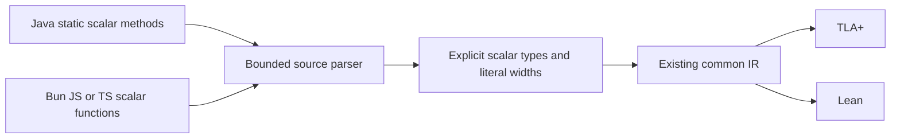

# Source Frontends

## Purpose and Scope
Versioned scalar source conversion for Swift, Rust, C, C++, Go, TypeScript, JavaScript, Python, Java, and Bun. Parent: [FormalCompiler](../DESIGN.md). No children.

## Responsibilities and Boundaries
Own tokenization, restricted grammar, type checking, and lowering. SourceCompiling is the public boundary. SourceLanguage exposes the versioned profile identity and input assumptions; this contract owns integer and overflow policy. No external parser, Skeleton, source execution, or language inference participates in conversion.

## Related Designs
| Design | Relationship | Contract Used | Summary | Cautions |
|---|---|---|---|---|
| [Compiler](../DESIGN.md) | parent | Frontend composition | Produces common IR | Experimental output only |
| [IR](../../FormalIR/DESIGN.md) | depends on | Typed scalar instructions | Language-independent output | Failures retain their kind |

## Architecture
```text
Source request -> bounded lexer -> language grammar -> typed expressions/CFG -> IR validation
```

## Contracts and Invariants
The versioned scalar profiles accept ASCII pure functions (Java static methods inside one class), scalar parameters and results, decimal literals, immutable locals, +, -, *, comparisons, direct positional calls, returns, and conditional returns. Branches must both return; all functions require explicit return. Expressions and signatures are single-line; only function/block boundaries span lines. Contiguous ++/-- are recognized and rejected as unsupported update operators in C/C++, JS/TS, Go, and Swift; whitespace-separated unary minuses retain their meaning. Python and Rust retain their distinct repeated-unary-minus grammar. No language is accepted through another language's parser accidentally: signatures, literal suffixes, declarations, and statement boundaries are language-specific. C/C++ accept only int64_t/uint64_t, bool, and standard integer/Boolean includes; arithmetic literals require LL/ULL suffixes to avoid integer promotions. C/C++ function visibility starts at each function definition, includes self-recursion, and includes earlier definitions. Forward declarations/prototypes remain outside the profile; later definitions do not authorize earlier calls. C/C++ calls in arithmetic operands or call arguments are rejected to avoid unspecified evaluation order. Go requires a package declaration. Python requires int/bool annotations and spaces-only indentation. JS-family scalar-v2 accepts Number, BigInt and Boolean under the Number extension below. Dynamic coercion, reassignment, objects, imports, async and exceptions remain rejected. Rust overflow checks must be enabled; signed and unsigned overflow panic. [Go constant semantics](https://go.dev/ref/spec#Constants) distinguish untyped constant evaluation from typed arithmetic. Go typed integer arithmetic wraps. Untyped Go constant subexpressions are evaluated exactly before contextual conversion; conversion to int64/uint64 requires representability and never wraps. Constant-only comparisons preserve arbitrary-precision meaning before producing Boolean values. This source profile bounds each constant intermediate to 76 decimal digits, within Go's guaranteed minimum 256-bit constant precision; exceeding that profile budget is a diagnostic, never a fabricated result. Go short declarations still require a typed operand or a Boolean result, rather than introducing the excluded default int type. Swift arithmetic traps. C/C++ signed overflow is undefined behavior; unsigned wraps. Python int and JS/TS BigInt use arbitrary integers, not narrowed machine words. Rust/C/Go mixed integer types are rejected. Swift/Rust/Go local inference requires a typed operand or explicit annotation; default platform integer types are outside the profile. Swift argument labels are outside this source profile; the existing SIL path remains available.

Input assumptions: JS-family arguments have monomorphic scalar types inferred from their source or selected by the unresolved-numeric default; Python annotations describe exact built-in int/bool inputs, excluding subclasses; C data model is 64-bit int64_t/uint64_t, C++ has no overloads or user declarations. These assumptions are emitted in the draft report. This is a closed source subset, not an arbitrary-project compiler. Nested/chained comparisons are rejected. Unsupported syntax and types fail with a source position before artifact writing. No independent source-to-IR proof is claimed.

## State, Ownership, and Lifecycle
Parser and lowering state are invocation-local values. Maximum source bytes, tokens, parser recursion, total expression-tree depth, and integer digits bound host work. Each AST constructor carries its computed depth; the parser checks the prospective parent depth before creating it. Parentheses retain the child depth. No AST consumer receives an expression above maximumNesting. Type hints, call detection, and expression lowering use invocation-local explicit work stacks, so accepted left-deep expressions do not consume host call-stack depth. Constant evaluation remains depth-bounded by the same AST contract. Interpreter limits are operational failures, not source results.

## Failure, Concurrency, and Constraints
SourceDiagnostic carries language and token position for syntax errors; semantic errors are anchored to the owning function declaration. Duplicate names, unknown calls, missing returns, mixed types, and unsupported syntax fail explicitly. No global mutable state or subprocess exists in frontends.

## Verification and Change Impact
[Frontend tests](../../../Tests/FormalFrontendTests) own positive and negative grammar, overflow, calls, branches, and output decoding. Native tool differential checks and Lean/TLC execution check finite cases. New instructions require IR, both runtimes, emitters, and independent output decoders to change together. Source-to-IR semantic certification remains pending.

### Four-finding Regression Ownership
| Finding | Owner | Negative acceptance | Positive evidence |
|---|---|---|---|
| Update operators split into subtraction | SourceLexer | Prefix/postfix -- and ++ fail before lowering | Spaced double negation matches native, IR, TLA+, and Lean |
| Go untyped constants narrowed early | GoConstantEvaluator and SourceLowering | Unrepresentable contextual conversions and precision-budget exhaustion fail | Constant comparison, cancellation, mixed typed/constant expressions, and typed wrapping agree across all four paths |
| Parser recursion limit did not bound AST depth | SourceParser | The 12,128-byte nested-chain counterexample returns SourceDiagnostic, never a signal | At-limit nested chains remain valid; over-limit binary/unary/call nodes fail |
| C/C++ forward calls accepted without declarations | SourceLowering | A later definition does not satisfy an earlier call | Earlier definitions and self-recursion remain valid and agree across all four paths |

[FrontendRegressionTests](../../../Tests/FormalFrontendTests/FrontendRegressionTests.swift) own rejection, boundaries, and IR observations. [verify-regressions.py](../../../Tools/verify-regressions.py) owns actual CLI no-output checks, native compiler/runtime behavior, and actual emitted TLA+/Lean execution. Rejected input produces no IR or backend artifacts; positive counterparts establish output behavior. Existing backend runtimes and IR contracts are unchanged.


## Java and Bun Profiles

| Input | Accepted surface | IR meaning | Failure boundary |
|---|---|---|---|
| `java-scalar-v1` | One optional public/final class, static methods with optional access modifier, `int`/`long`/`boolean`, `final` locals, direct unqualified calls | `int` is signed 32-bit; `long` signed 64-bit; arithmetic wraps; Boolean is one bit | Reject instance members, fields, constructors, overloads, imports, inheritance, casts and implicit width conversions |
| `bun-scalar-v2` | JS/TS functions, optional scalar annotations and inferred results, immutable let/const locals | IEEE Number, arbitrary integers, Boolean; unconstrained types use the selected default | Reject coercion, arbitrary APIs, imports, objects, reassignment and async |



Java keywords, restricted type identifiers, and static signatures colliding with inherited Object instance methods are rejected in their relevant declaration positions. Java literal widths are intrinsic: unsuffixed decimal literals are int32 and
`L`/`l` literals are int64. Width mixing, including implicit widening, is outside
this profile and must fail rather than change the width of an intermediate
expression to match its assignment target. Minimum decimal values are accepted
only through an immediate unary minus; a parenthesized out-of-range positive
literal remains invalid. Java Unicode escapes, including those inside comments, and isolated CR line endings in the new profiles are rejected before tokenization. LF and CRLF remain accepted. Both widths wrap for addition, subtraction,
multiplication and negation. The existing width-generic IR and runtimes own
execution; their contracts and trusted bytes do not change. This follows
[JLS integer operations](https://docs.oracle.com/javase/specs/jls/se24/html/jls-4.html#jls-4.2.2)
and [integer literals](https://docs.oracle.com/javase/specs/jls/se24/html/jls-3.html#jls-3.10.1).

Bun is an explicit runtime profile for its JS/TS source surface, not a separate
language syntax. Its [TypeScript support](https://bun.com/docs/runtime/typescript)
does not imply source type checking by Bun. Formal's accepted annotation and
scalar typing assumptions are enforced by this frontend. All JS-family profiles now use the versioned Number contract below.

[JavaBunFrontendTests.swift](../../../Tests/FormalFrontendTests/JavaBunFrontendTests.swift)
owns integer widths, wrapping, literal boundaries, Boolean operations, grammar
rejection and independent artifact-data decoding.
[verify-java-bun.py](../../../Tools/verify-java-bun.py) owns native javac/java and
Bun execution compared with the IR, finite TLC/Lean outcomes, actual quantified
proofs, counterexamples and no-output CLI rejection. End-user conversion and
checking do not execute javac or Bun or acquire either runtime. The bundled JRE
continues to belong solely to formal tool execution. Compiler, package and CLI
composition must expose both profiles with their exact assumptions; source
semantic certification remains UNVALIDATED.


JS/TS/Bun scalar-v2 adds Number under [IR execution](../../FormalIR/Execution/DESIGN.md#binary64-number-contract). A bounded monomorphic type solver preserves explicit annotations, constrains BigInt from literals/calls, and defaults unconstrained JS numeric inputs to Number. Omitted JS-family parameter and result annotations are inferred; TypeScript without parameter annotations assumes the supported monomorphic scalar domain rather than arbitrary any. BigInt/Number arithmetic mixing is rejected. Decimal/exponent literals, strict numeric equality, division/remainder, unary negation, number predicates and truthiness feed dedicated IR operations. This supersedes scalar-v1 BigInt-only JS-family assumptions; unannotated cancellation now defaults to Number. Existing non-JS profiles retain their rules. Arrays, objects, strings, async and arbitrary libraries remain outside this scalar extension.

Type inference uses at most 200000 invocation-local scalar nodes. `--default-numeric number|bigint` (or ScalarSourceCompiler.defaultNumeric) selects only unconstrained types; annotations and literal/call constraints take precedence. Generation reports record this selection. Inference is monomorphic and rejects coercion and shadowing of numeric builtins. JS-family semicolon insertion is limited to supported single-line expressions at newline/closing-brace boundaries.

JS-family logical && and || require matching scalar operand types and return the selected operand. They lower to short-circuit CFG branches and a typed merge parameter, so an unevaluated RHS cannot execute or consume fuel. Union-valued logical expressions remain outside the monomorphic profile. Expression depth remains parser-bounded when lowering nested short-circuit RHS expressions.


### Review regression contracts
JS/TS/Bun accept LF and CRLF and reject every isolated CR before tokenization,
including inside comments. Return-line boundaries cannot be erased: a source
that returns undefined is outside the scalar profile and must fail before any
artifact is published. This preserves the existing LF/CRLF grammar and runtime
semantics.

Unary plus constrains its operand and result to Number during type resolution,
including across bindings and direct calls. Explicit BigInt and Boolean operands
remain errors under the no-coercion contract. The unresolved-numeric default is
applied only after these constraints. NumberFrontendTests owns rejection,
signature inference and exact signed-zero/NaN behavior; Tools/verify-number-regressions.py
owns native observations and real IR/Lean/TLC checking.


## Target source origin capture
The [Artifacts major-2 contract](../Artifacts/DESIGN.md) replaces the bare source-to-IR SDK. Tokenization must retain original half-open UTF-8 byte ranges before unescaping/normalizing token values. Syntax expressions/statements/functions retain those spans through type resolution/lowering. Display line/column data is derived and does not substitute for a byte range. NFC/NFD, escaped literals, comments and synthetic instructions must not create false precision. Supported language semantics and strict rejection remain unchanged; multiple-source/Actor support is not implied by source-map fields. Implementation acceptance is FE-01/02, owned by Artifacts/SDK transition.
