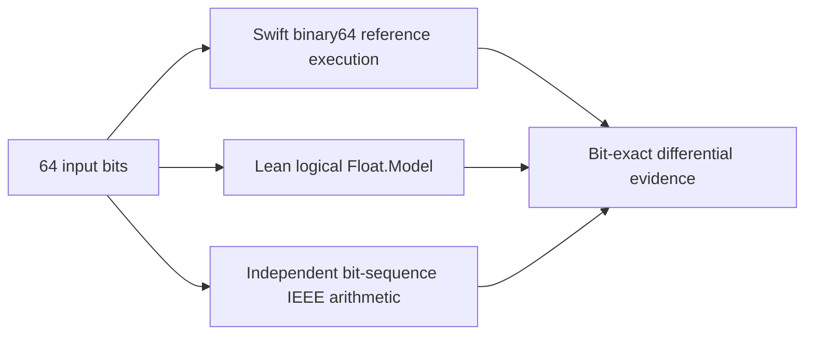

# Execution

## Purpose and Scope
Fixed-width arithmetic and a bounded small-step reference runner for differential tests. Parent: [FormalIR](../DESIGN.md). No children.

## Responsibilities and Boundaries
Own this contract only. No SIL decoding or backend formatting. No shared mutable state.

## Related Designs
| Design | Relationship | Contract Used | Summary | Cautions |
|---|---|---|---|---|
| [FormalIR](../DESIGN.md) | parent | Common semantics | Backend-independent model | Recheck all semantic consumers |

## Architecture
```text
Validated input -> Execution -> explicit result or typed failure
```

## Contracts and Invariants
Widths are 1...64 in the initial executable slice. Literals are bit patterns, not host Int values. Arithmetic wraps at the declared width, reports signed/unsigned overflow separately, and comparisons return one bit. Program counters point to individual instructions. Calls preserve caller SSA state; block assignment is simultaneous. Future memory/Actor operations require new explicit state and rules.

## State, Ownership, and Lifecycle
Program values are immutable Sendable records. Execution state belongs to a runner invocation. No raw pointers, actor-owned global state, or target-specific synchronization branches exist.

## Failure, Concurrency, and Constraints
Malformed programs fail validation. The runner enforces caller-selected fuel, stack, and value budgets and returns BOUND_EXCEEDED rather than success. A single task is modeled in this initial slice; Actor support remains pending.

## Verification and Change Impact
[Tests](../../../Tests/FormalIRTests) own behavioral evidence. Recheck parent, lowering, both emitters, and validator whenever instruction or state meaning changes.

## Mathematical Integer Execution
The [Program](../Program/DESIGN.md) contract owns integer representation and operations. This runner counts decimal digits as value-budget units and enforces caller-selected maximumIntegerDigits (default 4096) before arithmetic allocation; prospective operands above half the smaller digit/value capacity return boundExceeded. This conservative budget is operational, not a source exception. Integer addition/subtraction use linear digit work and multiplication uses quadratic digit work. Immutable storage is retained through Swift value semantics; canonical serialization is an output-boundary copy. Formal runtimes do not inherit runner bounds. Panic and undefinedBehavior are failed outcomes, separate from traps, returns, and bounds.


## Binary64 Number Contract

Binary64 owns the ECMAScript Number interpretation of 64-bit IR values. Number
arithmetic uses dedicated IROperation cases; integer/bitwise operators keep their
existing semantics. No real-number or mathematical-integer substitution is
permitted. Number operations require width 64 and produce either 64-bit values
or one-bit predicates. Values include subnormals, NaN, infinities and signed zero.
NaN payloads canonicalize because payload-observing memory APIs are outside the
scalar profile. Equality is IEEE numeric equality; SameValue distinguishes zeros
and equates NaNs. Negation preserves zero signs. Arithmetic is individually
rounded binary64, nearest ties-to-even; remainder is ECMAScript truncating fmod.



The host reference uses Swift Double under the supported macOS default IEEE
rounding environment; no fast-math or fused evaluation is introduced. Each IR
operation materializes bits before the next. Decimal parsing accepts bounded
ECMAScript decimal syntax and special scenario values; source literals preserve
signed zero and decimal rounding. Raw bit observations use bits: followed by
16 hex digits, so witnesses and scenarios never lose precision in JSON.

Lean uses the fixed bundled 4.35.0 Float.Model for + - * / and a controlled
integer remainder implementation, with kernel reductions and the existing
three-axiom allowlist. No native_decide, real approximation or new trust axiom
is accepted. TLA uses exact little-endian magnitudes, division with remainder,
rounding and bit packing, never TLC machine integers for significands. Existing
per-process budgets bound difficult models; exhaustion remains UNKNOWN.

NumberArithmeticTests and Tools/verify-numbers.py own native Node/Bun, Swift IR,
actual Lean and actual TLC bit comparisons, ties/subnormals/extrema, NaN and
signed-zero counterexamples, and actual all-input model proofs. Runtime edits
require new trusted hashes and invalidate artifacts using the old runtime;
regeneration is required. Source translation remains UNVALIDATED.

Lean sign inversion uses a conditional sign-bit insertion/removal with modulus for removal. This avoids kernel reduction of subtraction by a huge natural numeral while preserving every valid 64-bit input; native and TLA use the same sign-bit semantics and canonical NaNs.
