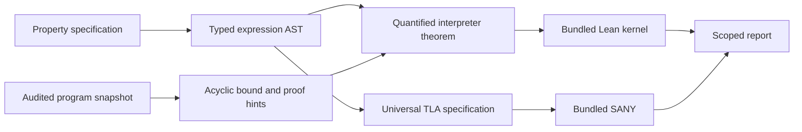

# Properties

## Purpose and Scope
Own universally quantified scalar preconditions and postconditions over audited generated programs. Parent: [FormalValidation](../DESIGN.md). No children. This extends finite case checking with actual Lean theorems over every typed input; it does not certify source translation.

## Responsibilities and Boundaries
Own strict property JSON, typed expression parsing, input interpretation, acyclic execution-bound analysis, proof-search hints, controlled Lean/TLA specification emission, universal verification and checked counterexamples. Consume the existing actual-output audit and pinned toolchain. FormalCompiler is not a dependency. A symbolic hint is never evidence: every successful theorem references the audited interpreter and actual Generated.program directly.

## Related Designs
| Design | Relationship | Contract Used | Summary | Cautions |
|---|---|---|---|---|
| [FormalValidation](../DESIGN.md) | parent | Independent verification | Composes checking modes | Preserve translation status |
| [Verification](../Verification/DESIGN.md) | depends on | ArtifactSnapshot, ScalarValueRenderer and LeanProofAudit | Audited immutable bytes and axiom checking | No arbitrary property code or lakefile execution |
| [FormalIR](../../FormalIR/DESIGN.md) | depends on | Validated program and bounded reference execution | Type checking, control-flow analysis and witness search | Search cannot establish a universal result |
| [ToolExecution](../ToolExecution/DESIGN.md) | depends on | Bounded process groups | Runs bundled Lean and Java | Resource exhaustion is UNKNOWN |
| [Toolchain](../Toolchain/DESIGN.md) | depends on | Verified tools and axiom allowlist | Offline proof checking | No new dependencies or native proof axioms |
| [Commands](../../formal/Commands/DESIGN.md) | used by | PropertyVerifying | check --properties | Mutually exclusive with --scenario |

## Architecture

## Contracts and Invariants
- Schema 1 property files contain 1...16 named properties. Each has entry, inputViews, resultView, requires and ensures. Input views explicitly select integer, signed bits, unsigned bits, Boolean or Number interpretation; their number/types must match the IR. No concrete input enumeration is required.
- The expression language accepts arg0...argN, result, canonical decimal integers, true/false, parentheses, arithmetic + - *, comparisons == != < <= > >=, and Boolean ! && ||. Types are checked; requires cannot reference result. Raw Lean/TLA syntax and unknown fields are rejected.
- For each property, PROVED means every typed input satisfying requires terminates normally within the derived execution bound and satisfies ensures in the actual generated Lean interpreter. Bit inputs quantify all bit patterns using Nat variables with explicit width bounds; integers quantify Int without input bounds; Booleans quantify Bool. Preconditions are part of the theorem, and satisfiability is not implicitly claimed.
- Only actual theorem success plus the standard axiom audit can produce PROVED. The theorem must depend only on propext, Classical.choice and Quot.sound; native reduction axioms, custom axioms and admissions are rejected. Tactics and helper lemmas are controlled by this component.
- Proof hints may reconstruct arithmetic expressions solely to choose logical case splits. The emitter canonicalizes bit-width numerals and hypotheses, then simplifies one interpreter step at a time before arithmetic proof search. They do not replace the interpreter, and a bad hint can only cause proof failure. Acyclic bounds are also untrusted: an insufficient bound makes the normal-termination theorem fail.
- The automatic execution profile supports reachable acyclic CFGs and acyclic direct calls, with at most 4096 derived execution steps and eight logical proof cuts. Hint expressions are capped at 32 KiB and generated proof source at 1 MiB. Cycles, indirect call targets or exhausted proof budgets return UNKNOWN rather than reducing an unbounded property to samples.
- Property input is at most 262144 bytes; each expression is at most 4096 bytes, 1024 tokens and depth 64; decimal constants have at most 256 digits. These are operational budgets, not restrictions on quantified integer values.
- Counterexample search uses at most 64 deterministic typed candidate tuples per property. It never proves a universal claim. COUNTEREXAMPLE requires a concrete witness refuted by the IR, a kernel-checked negation of the same interpreter obligation, and a matching TLC invariant violation. Search failure leaves UNPROVED/UNKNOWN.
- TLA Init ranges over every typed input satisfying requires and its temporal property describes the postcondition at terminal states. SANY checks the specification. TLC is not used to claim exhaustive checking of infinite or impractically large domains; reports say SPECIFICATION_GENERATED. Lean owns the universal proof and bounded normal termination.
- Universal reports use ALL_INPUTS_UNDER_PRECONDITIONS and retain translation UNVALIDATED. Exit 0 requires every property PROVED and every TLA specification parsed. A checked counterexample uses exit 5. UNPROVED, unsupported automatic proof shapes, timeouts and bounds use exit 6; audit failures use exit 4 and tool failures exit 7.

## Runtime Flows
Load and type-check the property file against the audited snapshot; preserve exact bytes and hashes in a unique run directory. Compile the audited runtime and program once. Derive the bound and proof hints, generate the quantified theorem and universal TLA specification, and run SANY and Lean. A bounded candidate search may run before proof search. Any candidate must be independently checked by an interpreter-negation theorem and a TLC invariant excluding precisely its observed bad outcome. This avoids TLC machine-integer limits when evaluating mathematical property expressions; the Lean counterexample theorem establishes the property violation. Persist all statuses, theorem source, logs, interpretation views, pre/postconditions, bounds, axioms and witness evidence.

## State, Ownership, and Lifecycle
All parser, graph, symbolic hint and verifier state belongs to the invocation. Snapshot bytes are read once and copied to private workspaces. Per-run and per-property output paths are unique. Existing source artifacts and previous runs are preserved.

## Failure, Concurrency, and Constraints
Reuse Verification's 120-second per-process default, 1...3600-second timeout, 2048 MiB Lean limit, 512 MiB Java heap, 8 MiB stream caps and 512 MiB monitored workspace budgets. Proof search is incomplete. Logical falsehood is reported only with a checked witness; a failed tactic does not establish falsehood. Arbitrary recursion and loop invariants require a future proof profile and remain explicit UNKNOWN here.

## Verification and Change Impact
[PropertyTests.swift](../../../Tests/FormalValidationTests/PropertyTests.swift) owns strict parsing/type errors, expression depth, input interpretations, bound/cycle analysis, candidate witnesses and axiom rejection. [Tools/verify-properties.py](../../../Tools/verify-properties.py) owns real bundled-tool proofs over unbounded Int and all-64-bit-input domains across eight profiles, branches, direct calls and preconditions; checked boundary counterexamples; rejection of mutated actual Program data; mixed rechecks; and failure to prove after candidate exhaustion. [Tools/verify-distribution.py](../../../Tools/verify-distribution.py) owns offline checking after packaging, installation and relocation with poisoned host tools. Changes to Runtime, emitted Program wrappers, proof hints or pre/postcondition rendering require rechecking both the kernel theorem and TLA specification. Existing source-to-model limitations remain unchanged.

Number properties add an explicit number view over width-64 patterns. Arithmetic, comparisons and classification use the [IR Number contract](../../FormalIR/Execution/DESIGN.md#binary64-number-contract), including NaN and signed zero. Numeric literals in Number properties round to binary64. All 64-bit patterns are quantified; helper hints remain untrusted. Witnesses serialize exact raw bits; unknown proofs remain failures. Integer/Boolean properties retain their meanings.

Binary64 arithmetic can make kernel checking substantially larger than integer arithmetic: the two-input addition theorem peaks around 1.2 GiB with the pinned Lean model. Property checking therefore uses a bounded 2048 MiB Lean budget; finite scenarios retain their 1024 MiB budget. Exhaustion remains UNKNOWN.

Each property owns a private Java temporary directory within its monitored TLA workspace, isolating SANY/TLC module extraction across invocations.

SANY success and diagnostic interpretation use Verification's
[SANYOutputAudit contract](../Verification/DESIGN.md#sany-diagnostic-contract),
including exact module completion and rejection of zero-exit semantic errors.
PropertyVerifier retains ownership of process/resource failures. This unifies
finite and universal checking without changing theorem or counterexample scope.

## Structured evidence change impact
[Inspection](../Inspection/DESIGN.md) and [SDK transition](../../../Documentation/SDK-TRANSITION.md) define the target structured-output/correspondence/graph contract. Preserve this component's actual semantic and trust invariants. Update direct callers/results/resource audits in the same cutover; do not add legacy-report adapters. User Lean elaboration requires its explicit isolation capability; current trusted generated-model tooling is not evidence of safe arbitrary Lean execution.
