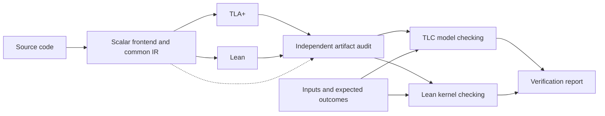
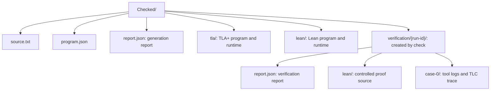
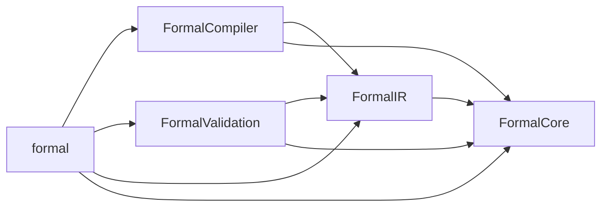

# swift-formal

**Formal models and verification evidence from source code.**

swift-formal is an experimental formal-verification toolchain for checking program logic with TLA+ model checking and Lean proofs. It translates supported source code into mathematical models, checks explicit inputs and expected outcomes, and preserves the models and verification evidence for inspection. The CLI is **`formal`**.

It supports scalar functions written in Swift, Rust, C, C++, Go, TypeScript, JavaScript, and Python through a shared intermediate representation.

## Why use swift-formal?

Use swift-formal to check whether supported program logic behaves as intended, investigate unexpected outcomes, and retain verification evidence you can inspect during a review and rerun after a code change.

- **Check boundary behavior.** Specify expected return values, traps, panics, and detected undefined behavior, then check those cases in generated TLA+ and Lean models.
- **Investigate mismatches.** Inspect TLC counterexamples, Lean proof source, and execution logs when a result differs from your expectation.
- **Repeat checks after changes.** Reuse scenarios with pinned verification tools and reports that record source hashes and tool versions.
- **Use one workflow across languages.** Generate and check supported functions with the same CLI while retaining each language profile's integer and overflow semantics.

This is useful for arithmetic and branching logic where boundary conditions and failure behavior matter. Installation manages Java, TLC, and Lean for you, and subsequent checks run offline.

The current release checks **explicit finite cases of the generated models**. General source-to-model semantic preservation and correctness for arbitrary inputs are not certified. Actor/async semantics and general application projects remain outside the supported scope. See [implementation progress](PROGRESS.md) for the current status.

## How it works

`formal check` compiles a supported source function into a common IR, generates TLA+ and Lean artifacts, audits their program data, and checks the supplied scenario with both TLC and Lean. Installation provisions the verification tools; generation and verification then run offline.



## Installation

The current distribution target is **macOS on Apple Silicon (arm64)**. The package declares macOS 13 and Swift tools 6.2 as its minimum versions. The tested Swift toolchain is 6.4.1.

### Install from source

Run from the package root. Building the package requires a Swift toolchain.

```sh
swift run -c release formal install --prefix "$PWD/InstalledFormal"
./InstalledFormal/bin/formal toolchain
```

`install` downloads pinned tools and places them inside the chosen prefix.

| Bundled tool | Version | Purpose |
|---|---|---|
| Eclipse Temurin JRE | 21.0.13+9 | Run TLC |
| TLA+ tools | 1.7.4 | Parse and analyze models with SANY; explore states with TLC |
| Lean | 4.35.0 | Check theorems about expected generated-model outcomes |

Archives are checked against pinned SHA-256 digests, and the extracted files are checked against a pinned inventory. Downloads are cached at `~/Library/Caches/formal/downloads`; use `--cache <directory>` to override this location. The extracted tools occupy about 3 GB, with about 1 GB of downloaded archives. The destination version and `bin/formal` must not already exist.

### Install from a binary distribution

If you have a portable distribution folder, install it with:

```sh
./Formal-macos-arm64/formal install --prefix "$PWD/InstalledFormal"
./InstalledFormal/bin/formal toolchain
```

The folder already contains its verification tools. This installation works offline and requires no Swift toolchain. You can also run `formal` directly from the distribution folder. Keep the executable, resource bundles, and `toolchain` directory together. See [distribution and installation](Documentation/DISTRIBUTION.md) for details.

## Quick start

Create the following two files in the working directory containing `InstalledFormal`.

`input.py`:

```python
def calculate(a: int, b: int) -> int:
    return a + b
```

`cases.json`:

```json
{
  "schemaVersion": 1,
  "fuel": 512,
  "cases": [
    {
      "name": "addition",
      "entry": "calculate",
      "arguments": ["2", "9"],
      "expected": { "status": "returned", "value": "11" }
    }
  ]
}
```

Generate both models and verify the case in one command:

```sh
./InstalledFormal/bin/formal check \
  --language python \
  --source input.py \
  --scenario cases.json \
  --output Checked
```

`Checked` must be a new directory, and its parent must exist. The verification report is written to standard output and `Checked/verification/<run-id>/report.json`. Each run also retains proof source, tool logs, and a TLC graph or counterexample.

### Read the results

| Field or status | Meaning |
|---|---|
| `artifactDataMatchesIR: true` | Independent decoders read the actual TLA+ and Lean program data and confirmed agreement with the IR |
| `tlc: MODEL_CHECKED` | TLC completed exploration of the specified case, checked the expected outcome, and reached a terminal state |
| `lean: PROVED` | Lean checked a theorem about the expected outcome of the specified case |
| `COUNTEREXAMPLE` / `UNPROVED` | TLC found a counterexample, or Lean could not prove the expected outcome |
| `UNKNOWN` | Verification did not complete because of a computation bound, timeout, or other resource limit |
| `translation: UNVALIDATED` | General source-to-model semantic preservation has not been certified |

For `PROVED` results, axiom dependencies must be within the pinned allowlist: `propext`, `Classical.choice`, and `Quot.sound`. Actual dependencies are recorded in `leanAxioms`. Admissions through `sorryAx` and custom axioms are rejected. Changing an expectation checks that new expectation; success applies only to the supplied cases.

### Recheck generated artifacts

```sh
./InstalledFormal/bin/formal check \
  --artifact Checked --scenario cases.json --timeout 120
```

Each invocation creates a new run directory. `--timeout` limits each external process and defaults to 120 seconds. A scenario supports up to 32 cases and `fuel` from 1 through 4096. Arguments and expected values are strings. Expectations can describe a returned value or a `trapped`, `panic`, or `undefinedBehavior` outcome. See the [scenario specification](Documentation/DISTRIBUTION.md#generate-and-check) for schema and resource limits.

## Supported languages and scope

| Language | `--language` | Types and assumptions |
|---|---|---|
| Swift | `swift` | `Int64`, `UInt64`, `Bool`; unlabeled arguments |
| Rust | `rust` | `i64`, `u64`, `bool`; Rust 2021 with overflow checks enabled |
| C | `c` | `int64_t`, `uint64_t`, `bool`; standard headers; C11 |
| C++ | `cpp` | `int64_t`, `uint64_t`, `bool`; standard headers; C++20 |
| Go | `go` | `int64`, `uint64`, `bool`; package declaration required |
| TypeScript | `typescript` | Primitive `bigint` and `boolean` |
| JavaScript | `javascript` | Primitive BigInt arguments and results assumed |
| Python | `python` | Exact built-in `int` and `bool`; type annotations required |

The profiles accept standalone pure functions, immutable locals, integer arithmetic and comparisons, direct calls, and conditionals whose branches both return. Integer widths and overflow behavior follow each profile's language rules. Python `int` and JS/TS BigInt use arbitrary-precision integers.

General projects, classes and objects, mutable state and memory operations, exceptions, Actor/async, and JS/TS Number or implicit coercion are outside the current source profiles. Unsupported syntax is rejected with a source-position diagnostic. The [frontend contract](Sources/FormalCompiler/Frontends/DESIGN.md) defines the exact grammar and assumptions.

```sh
./InstalledFormal/bin/formal profiles
```

## Generate without verification

```sh
./InstalledFormal/bin/formal translate \
  --language rust \
  --source Fixtures/Sources/rust.source \
  --output DraftRust \
  --draft-unvalidated
```

Run this example from the package root. `--draft-unvalidated` is required and must be last. `translate` writes `DRAFT_UNVALIDATED` artifacts without running external verifiers.

### Output layout



## Build a distribution

```sh
swift run -c release formal package --output "$PWD/Formal-macos-arm64"
```

This creates a portable folder containing the executable, resources, verification tools, and licenses. Distribute the entire folder. The command prepares local files; release publication, signing, and notarization are separate operations.

## Package architecture

There are no external SwiftPM dependencies. Java, TLC, and Lean are managed during CLI installation and distribution preparation.



| Module | Responsibility |
|---|---|
| `FormalCore` | Shared metadata, diagnostics, and input-bundle integrity |
| `FormalIR` | Typed language-neutral IR and execution semantics |
| `FormalCompiler` | Language frontends, SIL processing, and TLA+/Lean emission |
| `FormalValidation` | Independent artifact decoding, tool management, and finite-case verification |
| `formal` | CLI composition for generation, verification, and distribution |

Structural SIL parsing and partial scalar lowering are also available as libraries. `capture`, `generate`, `validate`, `coverage`, and `replay` remain unimplemented and return exit code 3.

## Development and verification

```sh
swift build
python3 Tools/run-with-timeout.py --seconds 180 -- swift test
python3 Tools/run-with-timeout.py --seconds 90 -- python3 Tools/integration.py
```

The [verification record](Documentation/VERIFICATION.md) documents actual TLC/Lean checks, distribution relocation, execution with host tools blocked, native-language comparisons, and the limits of the evidence.

## Documentation

- [CLI and exit codes](Documentation/CLI.md)
- [Distribution, installation, and scenarios](Documentation/DISTRIBUTION.md)
- [Support matrix](Documentation/SUPPORT.md)
- [Design](DESIGN.md)
- [Trust boundary](Documentation/TRUST.md)
- [Implementation progress](PROGRESS.md)
- [Original specification snapshot](Documentation/SPEC.md)
